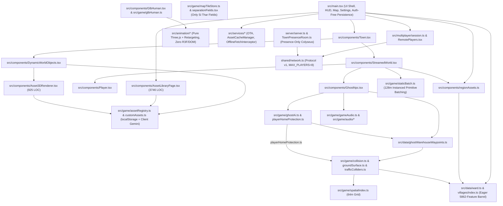
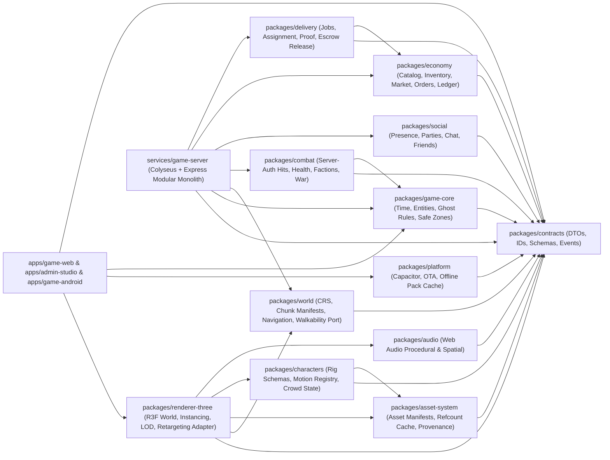

# 01 — Verified Dependency Map & Architectural Boundaries

Date: 2026-11-16
Phase: **Phase 0 (Audit & Plan Only)**

## 1. Current High-Level Dependency Graph (As Observed)

## 2. Clean vs. Coupled Seams (Evidence-Backed)

### Already Cleanly Separated Seams (Preserve & Build Upon)
1. **Multiplayer Trust & Module Boundary (`server/` + `shared/network.ts` <-> `src/`)**:
   - `server/server.ts`, `server/TownPresenceRoom.ts`, `server/state.ts`, and `shared/network.ts` have **zero imports** from `src/data/`, `src/components/`, `src/game/`, or `three`.
   - Verified in `server/tsconfig.json` (`include: ["./**/*.ts", "../shared/**/*.ts", "../tests/multiplayer.test.ts", "../src/multiplayer/session.ts"]`) and confirmed passing via `npm run server:check`.
   - `server/TownPresenceRoom.ts` explicitly documents why `presenceSpawn()` keeps static coordinates instead of importing `ward.ts`: importing eager client/map barrels into Node would drag Three.js/DOM globals and massive arrays into the server process.

2. **Core Animation & Retargeting Pipeline (`src/animation/core/`, `src/animation/retargeting/`, `src/animation/ghost/`)**:
   - `MotionLoader.ts`, `MotionRegistry.ts`, `MotionCache.ts`, `AnimationController.ts`, `SkeletonAnalyzer.ts`, and `SkeletonRetargeter.ts` import only `three` (`GLTFLoader`, `AnimationClip`, `AnimationMixer`, transform/quaternion math).
   - No React, `@react-three/fiber`, `localStorage`, or world-map coupling inside `core/` or `retargeting/`. (`src/animation/ui/SpecialActionMenu.tsx` and `src/animation/hooks/useSpecialActions.ts` hold React integration cleanly at the outer shell.)

3. **Bounded JSON Map Streaming (`src/game/mapTileStore.ts`, `src/game/mapProjection.ts`, `src/components/MapDataset.tsx`)**:
   - `mapTileStore.ts` (`validateManifest`, `MapTileIndex`, `fetchMapJson`, `MapTileStore`) is pure TypeScript/Fetch/GeoJSON without Three.js or eager `ward.ts` imports.
   - `SeparationFieldTiles.tsx` proves a working R3F adapter (`InstancedMesh` + `registerGroundRegion` + cleanup via `releaseGroundRegion` on unmount).

4. **Procedural Horror Audio Synthesis (`src/game/audio/*`, `src/game/ghostAudio.ts`, `src/game/gameAudio.ts`)**:
   - `GhostAudioEventScheduler.ts`, `warehouseSoundOrigins.ts`, `ProceduralHorrorSynth.ts`, `WarehouseAmbientBed.ts`, and `GhostSpatialAudioController.ts` use Web Audio API synthesis with pure pure-logic scheduling separated from R3F mount (`HauntedWarehouseAudioZone.tsx`). Zero network MP3/WAV/OGG fetches.

5. **Offline & OTA Cache Core (`src/game/otaCompatibility.ts`, `src/game/updateSafety.ts`, `src/services/assetCacheManager.ts`)**:
   - Pure compatibility/diff/SHA-256 verification state machines (`otaCompatibility.ts`, `updateSafety.ts`) sit cleanly separate from React UI (`UpdateStatusPanel.tsx`), `@capgo/capacitor-updater` bridge (`otaUpdater.ts`), and browser fetch interception (`offlineAssetResolver.ts`).

---

### Tightly Coupled Seams Requiring Incremental Untangling
1. **Eager Data Gravity Well (`src/data/ward.ts`, `src/data/villages/index.ts`, `src/components/regionAssets.ts`)**:
   - Although `regionAssets.ts` lazy-loads React *3D components* (`import('./villages/...')`), `regionAssets.ts`, `collision.ts`, `locationDetect.ts`, `mapLabels.ts`, and `regionObjectsMigration.ts` **eagerly import all 11 region geometry datasets** (`myothar`, `myotharCenterBuildings`, `kalayArea1Buildings`, and all 10 villages in `kalayVillages`).
   - Result: `5,862` feature records (`4.13 MiB` in `src/data/`) are parsed upfront and retained in `main` JS chunk, blocking nationwide scale.

2. **Ghost AI Coupled to Legacy Map Barrels & Global `localStorage` Edits**:
   - `src/game/ghostAi.ts` is ~95% deterministic simulation, **except** it directly imports `isGhostPointWalkable` from `src/data/ghostWarehouseWaypoints.ts`, which imports `canStand` / `treeBlocks` from `src/game/collision.ts` -> `src/data/ward.ts` & `src/data/villages/index.ts` -> all eager town/village data, AND reads `window.localStorage` (`sourceIsEdited`, `GHOST_WAYPOINTS_STORAGE_KEY`).
   - Blocking consequence: `GhostAiController` cannot run cleanly on the authoritative Node server without injecting walkability/geometry interfaces.

3. **Client Scene Graph Coupled to Physics (`src/game/groundSurface.ts`, `src/components/Player.tsx`, `src/game/trafficColliders.ts`)**:
   - Runtime height/walkable/vehicle checks query Three.js `Scene` objects (`sceneGround(scene, t)`, `trafficColliders` `WeakMap`/`Map` keyed by `Group`, `camera.userData.viewFocus`, `scene.getObjectByName('player-avatar')`).
   - This ties game physics directly to React Three Fiber render frames and scene tree layout.

4. **Asset Registry Bound to React Components & Client `localStorage` (`src/game/assetRegistry.ts`, `src/components/Asset3DRenderer.tsx`, `src/game/customAssets.ts`)**:
   - `ASSET_REGISTRY` identifies models by React component string (`sourceComponent: 'House' | 'KanbaleSchool' | ...`) resolved inside `Asset3DRenderer.tsx`.
   - `customAssets.ts` directly calls Google Gemini API from the browser with a user-supplied key (`x-goog-api-key`) and writes up to 200 JSON primitive recipes into `localStorage`.

5. **UI Shell God Component (`src/main.tsx` & `src/components/AssetLibraryPage.tsx`)**:
   - `main.tsx` (~1,390+ lines) combines R3F `<Canvas>`, intro state, HUD navigation, map UI, multiplayer session ownership, Capacitor lifecycle/OTA UI, save flushing, and keyboard/pointer locks.
   - `AssetLibraryPage.tsx` (3,746 lines) bundles 3D editor viewport controls, humanoid animation preview, AI generation UI, and custom asset persistence into one component.

6. **Client-Side Permission Trust (`src/game/mapPermissions.ts`, `src/game/homeAccess.ts`)**:
   - `getStoredMapRole()` defaults to `'admin'` when unset and trusts `?role=admin` or `localStorage`. `homeOwnership` is hardcoded static data (`farmhouse`).

## 3. Target Dependency Rules (After Migration Phases)

- **Strict Invariant**: `contracts`, `game-core`, `world`, `combat`, `economy`, `delivery`, and `social` **never import** `three`, `@react-three/fiber`, `react-dom`, `window.localStorage`, or `@capacitor/*`.
