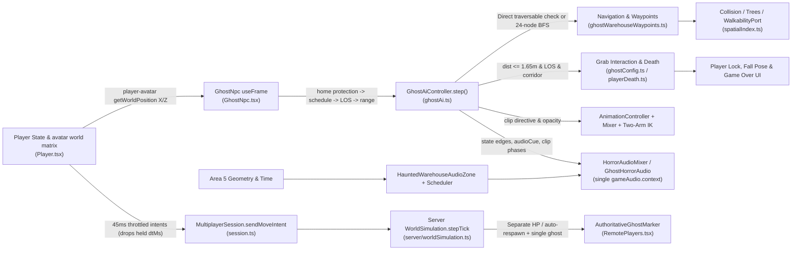

# Ghost AI, Horror Audio & Performance Audit Report (Parts 1–15)

Date: 2026-11-16, Asia/Rangoon (`+06:30`).  
**AUDIT COMPLETE; FIX PLAN NOT EXECUTED.** After the audit-first instruction in [ghost-ai-audio-performance-audit.md](file:///c:/Users/EBPMyanmar/Desktop/Myanmar-Town-Prototype/ghost-ai-audio-performance-audit.md), no production fixes or debug overlays were implemented beyond pre-existing repository work; this report consolidates all Part 1–15 findings, measurement tables, runtime probe telemetry, debug tool specification (Part 13), structured defect cards (Part 14), and prioritized remediation roadmap (Part 15).

---

## Executive Summary

- **Local Ghost AI Lifecycle (`GhostAiController` + `GhostNpc`)**: Verified in isolated browser runtime ([`behavior-runtime.json`](file:///c:/Users/EBPMyanmar/Desktop/Myanmar-Town-Prototype/artifacts/ghost-audit/behavior-runtime.json)) and full-world probe ([`full-game-probe.json`](file:///c:/Users/EBPMyanmar/Desktop/Myanmar-Town-Prototype/artifacts/ghost-audit/full-game-probe.json)). All three personalities (`Hunter`, `Ambusher`, `Stalker`) detect, approach, chase, grab, and trigger the local Game Over state even when `.opus` requests fail or are blocked, with zero runtime exceptions.
- **Full-Game Probe (Latest Authoritative Rerun)**: On `src/main.tsx` + `Player` + `Town` (`?ghost=debug&quality=mobile` at Warehouse Row saved coordinates `(35.149, 36.176)`, manual night, valid gesture unlock), the game reached `game-ready` cleanly with zero console/runtime errors, active `ghost-1` transitioning `SPAWNING -> CHASING` at `distToPlayerM: 19.135`, all three logical haunt zones assigned, and `HorrorAudioMixer` decoding and playing `ambience/warehouse-drone.opus`, `ambience/eerie-wind.opus`, and `ambience/chase-tension.opus` (`bedMode: "opus"`, `opusSupport.runtimeDecodeOk: true`, `lastPlaybackError: null`).
- **Four Reproduced & Failing Audit Defects**: [tests/ghostAuditReproductions.test.mjs](file:///c:/Users/EBPMyanmar/Desktop/Myanmar-Town-Prototype/tests/ghostAuditReproductions.test.mjs) reliably reproduces **4 failing behaviors (`0 passed, 4 failed`)** covering multiplayer movement-time loss (`F01`, P0), server grabs through impassable barriers (`F02`, P1), low-FPS simulation clock loss (`F03`, P1), and unthrottled empty-route path replanning (`F06`, P2). Seven additional code-level / integration risks (`F04`, `F05`, `F07`, `F08`, `F09`, `F10`, `F11`) and one hardware/device verification boundary (`F12`) are catalogued below.
- **Historical Check Note**: The older random-approach gating defect (`artifacts/performance-audit/ghost-proximity-before.log`) was fixed before this audit began; `tryHandleProximityEncounter` now initiates detection deterministically without random suppression (`F01`–`F12` reflect the current repository only).

---

## Evidence Baseline & Executed Commands

- **Source snapshot**: Captured `366` source/config files (`19,784,999` bytes) under `artifacts/ghost-audit/snapshot/` (`source-manifest.json`, `source-drift.json` = `[]`).
- **Existing unit & integration suite (`npm test`)**: **316 passed, 0 failed, 0 skipped** (includes [horrorAudioPack.test.ts](file:///c:/Users/EBPMyanmar/Desktop/Myanmar-Town-Prototype/tests/horrorAudioPack.test.ts), [ghostAudio.test.ts](file:///c:/Users/EBPMyanmar/Desktop/Myanmar-Town-Prototype/tests/ghostAudio.test.ts), [hauntedWarehouseAudio.test.ts](file:///c:/Users/EBPMyanmar/Desktop/Myanmar-Town-Prototype/tests/hauntedWarehouseAudio.test.ts), [ghostNpc.test.ts](file:///c:/Users/EBPMyanmar/Desktop/Myanmar-Town-Prototype/tests/ghostNpc.test.ts), [ghostProximity.test.ts](file:///c:/Users/EBPMyanmar/Desktop/Myanmar-Town-Prototype/tests/ghostProximity.test.ts), [ghostPersonalities.test.ts](file:///c:/Users/EBPMyanmar/Desktop/Myanmar-Town-Prototype/tests/ghostPersonalities.test.ts), [playerHomeProtection.test.ts](file:///c:/Users/EBPMyanmar/Desktop/Myanmar-Town-Prototype/tests/playerHomeProtection.test.ts), [offlineAssets.test.ts](file:///c:/Users/EBPMyanmar/Desktop/Myanmar-Town-Prototype/tests/offlineAssets.test.ts), [otaUpdate.test.ts](file:///c:/Users/EBPMyanmar/Desktop/Myanmar-Town-Prototype/tests/otaUpdate.test.ts)).
- **Reproduction suite (`node --experimental-strip-types --test tests/ghostAuditReproductions.test.mjs`)**: **0 passed, 4 failed** (intentionally red proofs of `F03`, `F02`, `F01`, `F06`).
- **Build & static checks**: `npx tsc -b`, `npm run build` (`vite build`), `npm run server:check` (`tsc -p server/tsconfig.json`), `npm run map:audit`, `npm run ota:manifest -- --channel production`, `npm run ota:verify`, `npx cap sync android` — all exited `0`.
- **Browser & simulation harnesses**: Desktop Windows Chrome headless (`ANGLE SwiftShader`, `640x480`, `dpr: 1` / `0.85`):
  - `npm run test:audio:browser` ([scripts/checkGhostAudio.mjs](file:///c:/Users/EBPMyanmar/Desktop/Myanmar-Town-Prototype/scripts/checkGhostAudio.mjs))
  - `node scripts/auditFullGameRuntime.mjs` -> `artifacts/ghost-audit/full-game-probe.json`
  - `node scripts/auditGhostBehaviorRuntime.mjs` -> `artifacts/ghost-audit/behavior-runtime.json`
  - `node scripts/auditAudioPerformance.mjs` -> `artifacts/ghost-audit/audio-performance.json`
  - `node scripts/auditGhostRuntime.mjs` -> `artifacts/ghost-audit/render-scaling.json`
  - `node --experimental-strip-types scripts/auditGhostSimulation.mjs` -> `artifacts/ghost-audit/simulation-performance.json`
  - `node --experimental-strip-types scripts/auditGhostCollision.mjs` -> `artifacts/ghost-audit/collision-path-performance.json`
- **Verification Limits**: Physical Android APK runtime/thermal soak, physical GPU FPS, human acoustic listening on speakers/headphones, native AudioBuffer/DSP C++ heap attribution, and live multi-client WebSocket match combat remain **NOT VERIFIED**.

---

## Parts 1–12 Technical Architecture Summary

### Part 1 — End-to-End Dependency Flow

### Inactivity Gates & Conditional Early Returns

| Layer | File & Symbol | Gate / Early Return Condition | Runtime Effect |
|---|---|---|---|
| Canvas Frameloop | `src/main.tsx` (`Canvas`) | `frameloop={visible ? "always" : "never"}` | Pauses all `useFrame` ticks when tab hidden or Android backgrounded. |
| World NPC Fragment | `src/components/StreamedWorld.tsx:394-408` | `!paused && started && !diagnosticConfig.disableNPCs && !hideNpcsDuringHighIntro` | Suppresses both `GhostNpcs` AND `HauntedWarehouseAudioZone` (`F07`). |
| Zone Assignment | `src/game/ghostConfig.ts` | `selectActiveGhostZones(3)` | Spreads 3 ghosts across separated zones; only zones <= 118m arm GLB loads. |
| Model Arming | `src/components/GhostNpc.tsx:346-376` | `!paused`, `enabled`, `scheduleActive`, `'playerOccupied' in camera.userData`, `dist <= 118m` | Prevents GLB fetch until player nears haunt corridor and `Player` attaches camera metadata. |
| Model Mount | `src/components/GhostNpc.tsx:402` | `if (!modelGltf) return null` | Delays `GhostAiController` instantiation until GLB loads; failed loads lack automatic retry (`F05`). |
| Rig Frame | `src/components/GhostNpc.tsx:687-690` | `if (!rig \|\| !root \|\| paused) return`, `dt = Math.min(delta, 0.05)` | Freezes AI when paused; discards elapsed wall time above 50ms (`F03`). |
| AI Step | `src/game/ghostAi.ts:844-915` | `checkHomeProtected`, `!input.activeBySchedule`, `distFromZone > aiSuspendDistanceM (150m)`, `playerInVehicle` | Enforces home safe zone first; suspends far actors (`> 150m`). |
| Visual / Mixer Culling | `src/components/GhostNpc.tsx:870,910` | `withinVis <= 210m`, `aiSuspendDistanceM <= 150m` | Hides mesh & suspends `AnimationMixer` at distance while keeping AI running up to `150m`. |
| Warehouse Ambience | `src/components/HauntedWarehouseAudioZone.tsx:42-104` | `enabled && soundEnabled && soundVolume > 0 && !paused`, `gameAudio.context?.state === 'running'` | Decoupled from ghost night AI & ghost visibility; quieter by day (`0.28x`), intense at night. |

### Parts 2–12 Verification Summary

- **Spawn, Detection, Movement & Kill Chain (`GhostAiController`)**: Configured personalities (`Hunter`: `25m / 4.2 m/s`, `Ambusher`: `5m / 4.8 m/s`, `Stalker`: `12m / 3.8 m/s`, Stalker observation `0.65s`, attack range `1.65m`) transition reliably across `SPAWNING -> HIDING -> OBSERVING_PLAYER/SCARING -> CHASING -> GRABBING -> RECOVERING/COOLDOWN`. Planar X/Z distances using `player-avatar.getWorldPosition` match world space under translated parents.
- **Player Home Safe Zone**: Client checks exact saved polygon or fallback circle (`174.891, 183.666`, radius `18m`, buffer `5m`) ahead of schedule, detection, chase, or catch; triggers `RETREAT -> FADE_OUT -> COOLDOWN`. Server uses default fixed safe-zone circle unless `WalkabilityPort.isHomeProtected` is explicitly injected.
- **Horror Audio Pack & Fallback**: `HorrorAudioRegistry`, `HorrorAudioAssetLoader`, and `HorrorAudioMixer` decode all `11` mono `.opus` files (`48kHz`) on a single shared `AudioContext`, apply HRTF spatial panning + occlusion lowpass filters, keep warehouse ambience persistent across short SFX and daytime/night, and fall back to procedural `GhostHorrorAudio` (`22` presets) and `WarehouseAmbientBed` (`6` sources) when `.opus` fails or is unsupported.

---

## Latest Full-Game Probe Result (`artifacts/ghost-audit/full-game-probe.json`)

Executed via [scripts/auditFullGameRuntime.mjs](file:///c:/Users/EBPMyanmar/Desktop/Myanmar-Town-Prototype/scripts/auditFullGameRuntime.mjs) against actual `src/main.tsx` + `Player` + `Town` (`http://127.0.0.1:5201/?ghost=debug&quality=mobile`, fresh temporary Chrome profile, saved position `(35.149, 36.176)`, manual `night`, `sound: true`, `volume: 0.3`, `intro: off`, no manual keyboard/mouse movement intervention):

| Probe Dimension | Observed Result (`full-game-probe.json`) | Notes & Attribution |
|---|---|---|
| Startup Stages & Memory | `ready: true`, `lastCompletedStage: "game-ready"`, `firstFrameMs: 12200.1`, `timeToReadyMs: 27119.1`, `contextLostCount: 0`, `lastCrash: null` | Heap progression: `43.8 MiB` (boot) -> `93.4 MiB` (first-frame) -> `119.7 MiB` (textures) -> `354.4 MiB` (building-geom) -> `397.6 MiB` (game-ready) -> `418.7 MiB` (final). |
| Active Ghost Zones (`extra.zones`) | `3` zones: `ghost-1` (`warehouse-row`, `35.149, 36.176`), `ghost-2` (`monastery-pitch-edge`, `141.421, -70.711`), `ghost-3` (`rice-mill-south`, `262.337, 184.555`) | Only `ghost-1` mounted its GLB (`ghost-2` ~150.7m, `ghost-3` ~271.3m exceed `assetLoadDistanceM = 118m`). |
| Live Ghost Progression | Initial spawn snapshot: `state: "SPAWNING"`, `opacity: 0.056`, `distToPlayerM: 19.135`, `chaseThreshold: 5`, `clip: dig`. Final snapshot (+8s + 3s): `state: "CHASING"`, `opacity: 1`, `visible: true`, `hasLineOfSight: true`, `homeProtected: false`, `attackEnabled: true`, `collisionEnabled: true`, `encounterCount: 1`, `chaseTriggerCount: 1`, `chaseSpeed: 0.300`, `activeClip: { clipId: "flee_02", speedScale: 0.25 }`, `x: 50.511, z: 24.793`, `distToPlayerM: 19.135` | Confirms real full-app GhostNpc spawn, line-of-sight acquisition inside Hunter 25m range, transition to `CHASING`, and movement/chase activation without manual chase triggers. (`gameOver: false` in the 11s capture window at SwiftShader frame rates.) |
| Render Perf (`extra.perf`) | `fps: 1.7` (`p50Fps: 1.5`, `minFps: 0.4`), `avgFrameMs: 574.8`, `p95FrameMs: 1228`, `p99FrameMs: 1491.9`, `maxFrameMs: 2772.3`, `drawCalls: 1737`, `triangles: 639,015`, `geometries: 1542`, `textures: 6`, `dpr: 0.85`, `sampleCount: 11` | Captured on desktop headless ANGLE SwiftShader (`mobile` quality preset). Not physical GPU or physical Android WebView performance. Also demonstrates real relevance of `F03` (<20 FPS time dilation). |
| Horror Audio State (`extra.audio`) | `audioContextState: "running"`, `soundEnabled: true`, `masterVolume: 0.3`, active buses: `ambience (1.0 / 2v)`, `ghostEffects (0.7 / 0v)`, `horrorEvents (1.0 / 0v)`, `chaseMusic (1.0 / 1v)`, `warehouseZoneStatus: { band: "encounter", inZone: true, preloaded: true, distanceM: 0, period: "night", bedMode: "opus", sources: 2, nodes: 4, disposed: false }`, `currentGhostState: { ghostId: "ghost-1", state: "CHASING", distToPlayerM: 19.1, chaseActive: true }`, `currentAudioFile: "ambience/chase-tension.opus"`, `lastPlaybackError: null`, `opusSupport.runtimeDecodeOk: true` (`oggOpus: "probably"`) | Zero runtime/console errors (`errors: []`). Proves real full-app Opus decode + dual ambience loop + chase tension activation synchronized with `ghost-1` entering `CHASING`. |

---

## Measurement Tables (`artifacts/ghost-audit/`)

### Table 1 — Ghost AI Simulation Scaling (`simulation-performance.json`, Node after warmup, 200 frames = 10 sim s)

| Mode | Ghost Count | Mean Batch (ms) | P95 Batch (ms) | Max Batch (ms) | Collision Callback Ms (Checks) | Path Calls | Total Displacement (m) | Stalled | Heap Delta (MiB) |
|---|---:|---:|---:|---:|---:|---:|---:|---:|---:|
| `near-chasing-open` | 1 | 0.025 | 0.069 | 1.781 | 0.451 (1,969) | 0 | 40.635 | 0 | +1.28 |
| `near-chasing-open` | 3 | 0.047 | 0.092 | 3.435 | 0.885 (5,919) | 0 | 124.580 | 0 | -2.23 |
| `near-chasing-open` | 10 | 0.044 | 0.129 | 1.915 | 1.801 (19,726) | 0 | 414.375 | 0 | -1.18 |
| `near-chasing-open` | 50 | 0.147 | 0.459 | 0.683 | 6.766 (98,658) | 0 | 2,081.210 | 0 | -0.42 |
| `near-chasing-open` | 100 | 0.255 | 0.886 | 1.884 | 13.529 (197,296) | 0 | 4,151.775 | 0 | +1.75 |
| `far-suspended` | 1 | 0.002 | 0.003 | 0.034 | 0.000 (0) | 0 | 0.000 | 0 | +0.34 |
| `far-suspended` | 3 | 0.005 | 0.010 | 0.070 | 0.000 (0) | 0 | 0.000 | 0 | +0.86 |
| `far-suspended` | 10 | 0.012 | 0.015 | 0.076 | 0.000 (0) | 0 | 0.000 | 0 | +2.68 |
| `far-suspended` | 50 | 0.029 | 0.053 | 0.734 | 0.000 (0) | 0 | 0.000 | 0 | -5.54 |
| `far-suspended` | 100 | 0.046 | 0.057 | 0.910 | 0.000 (0) | 0 | 0.000 | 0 | +3.47 |

*Microbenchmark note (`collision-path-performance.json`, authored Area 5 warehouse map): `10,000` walkability/capsule/tree queries (`6,525` valid) averaged `0.0208 ms` (p95 `0.0482 ms`, max `0.7118 ms`); `2,000` BFS queries over `24` waypoints averaged `0.0042 ms` (p95 `0.0091 ms`, max `0.6091 ms`).*

### Table 2 — Ghost Render Scaling (`render-scaling.json`, real `GhostNpc` + GLB + `AnimationMixer`, Chromium SwiftShader)

| Mounted / Visible Ghosts | Sampled Frames | Mean Frame (ms) | Avg FPS | Max Draw Calls | Max Triangles | Max Textures | Total AI / Blend / Anim CPU (ms) | JS Heap (MiB) |
|---:|---:|---:|---:|---:|---:|---:|---:|---:|
| 1 | 210 | 16.67 | 60.00 | 1 | 19,097 | 4 | 17.4 / 1.9 / 30.1 | 53.80 |
| 3 | 114 | 31.36 | 31.89 | 3 | 57,291 | 6 | 22.2 / 1.5 / 43.1 | 43.26 |
| 10 | 40 | 87.61 | 11.41 | 10 | 190,970 | 13 | 34.7 / 2.0 / 45.1 | 47.39 |
| 50 | 8 | 434.76 | 2.30 | 50 | 954,850 | 53 | 8.3 / 0.6 / 37.7 | 52.80 |
| 100 | 4 | 835.30 | 1.20 | 100 | 1,909,700 | 103 | 9.0 / 0.6 / 34.1 | 68.28 |

### Table 3 — Behavior Runtime Proof (`behavior-runtime.json`, 3 Real `GhostNpc` Personalities in Authored Warehouse Row)

| Ghost ID | Personality | Approach Anchor `(x, z)` | Initial Dist -> State | States Observed | Moved (m) | Outcome / Verification |
|---|---|---|---|---:|---:|---|
| `ghost-1` | Hunter (`25m`, `4.2 m/s`) | `(67.530, 36.929)` | `16.22m` -> `CHASING` | `CHASING`, `GRABBING` | 20.406 | Reached `1.589m`, `grabbed: true`, `audioCue: grab-impact` |
| `ghost-2` | Ambusher (`5m`, `4.8 m/s`) | `(16.521, 58.690)` | `59.62m` -> `HIDING` | `HIDING`, `CHASING`, `GRABBING` | 2.899 | `grabbed: true` -> lethal death (`phase: dead`, Game Over overlay `true`) |
| `ghost-3` | Stalker (`12m`, `3.8 m/s`) | `(59.762, 28.611)` | `48.02m` -> `HIDING` | `OBSERVING_PLAYER`, `CHASING`, `GRABBING` | 8.412 | Observed, chased, `grabbed: true` |

- Additional verified guards in `behavior-runtime.json`: `audioBlocked: true` (all 3 ghosts still approached & grabbed with `.opus` blocked), `safeHome` teleport triggered `COOLDOWN` (`homeProtected: true`, `attackEnabled: false`, `visible: false`), `pausedUnchanged: true`, `registryReleased: true`, `errors: []`.

### Table 4 — Horror Audio Performance & Lifecycle (`audio-performance.json`, Chromium Web Audio)

| Phase / Cycle | Frames / Mean (ms) | Script / Task (ms) | Bed Mode / Sources / Nodes | Cumulative Allocated Nodes / Started (Peak) | Loaded IDs / PCM Memory | JS Heap (MiB) |
|---|---|---|---|---|---|---|
| `baseline` (outside zone) | 209 / 16.752 | 83.03 / 201.08 | `inactive` / `0` / `0` | 103 / 3 (24) | 5 / 7.51 MiB (`7,872,000` B) | 11.70 (delta 6.37) |
| `first` (inside zone) | 209 / 16.752 | 51.55 / 131.43 | `opus` / `2` / `4` | 183 / 14 (24) | 5 / 7.51 MiB + 5.86 MiB loops | 23.62 (delta 6.59) |
| `loaded` (all 11 clips) | — | — | `opus` / `2` / `4` | 183 / 13 (24) | 11 / 11.35 MiB (`11,904,000` B) | 23.81 |
| `cycles` 0..2 (`exit` -> `entry`) | — | — | `exit: inactive 0/0` -> `entry: opus 2/4` | Exit 2 Heap: `22.39 MiB` / Entry 2: `22.80 MiB` | All 11 cached (`0` re-fetches, `0` re-decodes) | 22.12–22.80 |
| `burst` (50 cached shrieks) | — | — | — | Final total: `1,055` allocated / peak `242` started | `18` Opus + `24` procedural (`42` total active!) | 23.54 (`final`) |

- Single shared `AudioContext` (`contexts: 1`). Decode elapsed promise times measured across the 5 initially loaded clips: `12.70 ms` (`wood-cracks`, `5,102 B`), `21.90 ms` (`rusted-door-creak`, `16,046 B`), `26.20 ms` (`distant-footsteps`, `13,125 B`), `91.90 ms` (`eerie-wind`, `74,081 B`), `126.40 ms` (`warehouse-drone`, `86,855 B`); `allLoadMs: 88 ms`. Observed whole-page long tasks `[159, 71, 549]` ms include setup/canvas tasks and are not isolated to audio decode GC.

---

## PART 13 — Runtime Debugging Tools Recommendation (Approval Required)

> **Status**: Not implemented yet beyond existing pre-audit audio panel (`AudioDiagnosticsPanel.tsx`) and `window.__GHOST_NPC__` test handle. Approval required before adding AI overlay UI or 3D debug renderers.

### What Exists Today vs. Missing Part 13 Capabilities

- **Existing**:
  - `src/components/AudioDiagnosticsPanel.tsx` + `src/game/audio/horrorAudioDiagnostics.ts`: shows `AudioContext` state, sound enabled, master volume, 4 bus gains/voices, warehouse zone status, primary ghost state/distance, current file, Opus support, last playback error, and `Test Audio` button (`?dev` / `?diag` / `DEV` only).
  - `src/components/GhostNpc.tsx` (`ghostDebugRegistry` -> `window.__GHOST_NPC__`): exposes `getSnapshots()` programmatically in runtime.
  - `src/game/perfMetrics.ts`: collects scene-wide FPS, frame ms percentiles, DPR, draw calls, triangles, geometries, heap.
- **Missing for Ghost AI & Performance Audits**:
  - No live UI for **all mounted/dormant ghosts independently**, movement velocity, active target coordinates, BFS waypoint queue / last replan status & reason, last state-transition timestamp & age, attack cooldown timer, per-ghost home buffer state, inactivity/skip gate reason (`paused`, `schedule`, `far-suspended >150m`, `playerInVehicle`, `model-failed`), AI/pathfinding/mixer CPU micro-timings, or 3D spatial debug gizmos.

### Proposed Architecture: Development-Only Ghost AI & Audio Debug Overlay

1. **Strict Production Exclusion (`Zero Production Cost`)**:
   - Guard BOTH React rendering and R3F 3D debug geometry under `isGhostDevUiAvailable() || diagnosticConfig.enabled` (active only when `import.meta.env.DEV` is true or explicit URL dev/diag flags `?dev`, `?diag`, `?ghost`, `?ghostDebug` are set).
   - Wrap 3D gizmos in React `lazy()` (or exclude via conditional branch cleanly so standard production gameplay pays zero extra geometry/shader/material allocations and zero `performance.now()` timing hooks when closed).
2. **Throttled Telemetry Store (`zero per-frame React state updates`)**:
   - Extend `ghostDebugRegistry` or create `src/game/audio/ghostDebugStore.ts` backed by `useSyncExternalStore` + a `200 ms` (`5 Hz`) flush interval **active only while debug subscribers count > 0**.
   - Avoid calling `setState` inside `useFrame`; sample `performance.now()` inside `LoadedGhostNpc` / `WorldSimulation` only when debug telemetry is enabled.
3. **Required 16 Overlay Fields (Per-Ghost Selector + Summary)**:
   - **Entity Identity & Lifecycle**: `Ghost ID` (`ghost-1`..`ghost-N`), `Personality`, `Mount/Model/Clip Status` (armed / failed / ready), `Inactivity / Skip Reason` (`schedule-day`, `home-protected`, `paused`, `vehicle-occupied`, `dist > 150m`, `model-load-failed`, or `active`).
   - **State & Sensing**: `Ghost State`, `Last State Transition` (previous -> current + `ageSec`), `Detection Radius` (effective m), `Player Distance` (planar XZ m + delta since last tick), `Safe-Zone Status` (inside radius vs buffer / polygon override vs fallback circle / retreat blocked).
   - **Movement & Navigation**: `Target Position` `(tx, tz)` + `Target Waypoint ID`, `Movement Velocity` (`chaseSpeed` / speed mps + actual displaced delta/dt), `Pathfinding Status` (`direct-corridor`, `bfs-queue(N)`, `blocked`, `lastReplanAgeMs`, `replanCount/s`).
   - **Combat & Cooldowns**: `Attack Cooldown` (`scareCooldownTimer`, `encounterCooldownTimer`, `grabPhase`), `Encounter Count / Threshold`.
   - **Audio & Perf Split Telemetry**: `Last Emitted Audio Event` (cue + asset + Opus/procedural mode + age), `Active Audio Voice Count` (Opus + synth + emitter slots), `AudioContext State`, `AI Update Time` (ms), `Audio Processing Time` (ms), `FPS / Frame Time` (from `perfMetrics`). Explicitly label audio as **Scheduled / Decoded / Graph-Active** — never falsely labeled "Hardware Audible".
4. **Optional 3D Visual Debug Gizmos (`Three.js` overlay group, disabled by default in prod & toggleable per-flag)**:
   - **Detection Radius Ring**: horizontal `RingGeometry` (`detectRadiusM` = `25m` / `12m` / `5m`, cyan idle -> amber observing -> red chasing).
   - **Attack / Grab Radius Ring**: `1.65m` crimson inner ring around each ghost's ground origin.
   - **Target Direction Vector**: single `Line` / arrow from `(ghost.x, y + 0.4, ghost.z)` to `(targetX, y + 0.4, targetZ)` (direct LOS green vs blocked orange).
   - **Current Navigation Path**: pooled `Line` strip tracing `current` -> `pathQueue[0..k]` waypoints + node spheres.
   - **Safe-Zone Boundary**: outlines the active boundary Polygon (or `18m` fallback circle) AND `+5m` retreat buffer ring from [playerHomeProtection.ts](file:///c:/Users/EBPMyanmar/Desktop/Myanmar-Town-Prototype/src/game/playerHomeProtection.ts) using reusable static geometries (`raycast = noRaycast` so click/teleport picking is never intercepted).

---

## PART 14 — Consolidated Findings Report

Classification key:
- **REPRODUCED**: Failure proven directly via deterministic test ([tests/ghostAuditReproductions.test.mjs](file:///c:/Users/EBPMyanmar/Desktop/Myanmar-Town-Prototype/tests/ghostAuditReproductions.test.mjs)) or stress benchmark ([audio-performance.json](file:///c:/Users/EBPMyanmar/Desktop/Myanmar-Town-Prototype/artifacts/ghost-audit/audio-performance.json)).
- **CODE-LEVEL RISK**: Defect verified in source control flow and data contracts; end-to-end live multi-step trigger not yet separately exercised in browser.
- **NOT VERIFIED**: Environment/device attribution boundary outside current headless desktop test harness.

---

### Finding F01 — Authoritative Player Movement Drops Elapsed Client Frame Time
- **Severity:** `P0`
- **Classification:** `REPRODUCED`
- **Affected file:** [src/components/Player.tsx](file:///c:/Users/EBPMyanmar/Desktop/Myanmar-Town-Prototype/src/components/Player.tsx), [src/multiplayer/session.ts](file:///c:/Users/EBPMyanmar/Desktop/Myanmar-Town-Prototype/src/multiplayer/session.ts), [server/worldSimulation.ts](file:///c:/Users/EBPMyanmar/Desktop/Myanmar-Town-Prototype/server/worldSimulation.ts)
- **Exact function:** `Player` frame loop; `MultiplayerSession.sendMoveIntent`; `WorldSimulation.processPlayerMovements`
- **Relevant line numbers:** `src/components/Player.tsx:710`, `src/multiplayer/session.ts:397-428` (`408-409`, `423`), `server/worldSimulation.ts:395-454` (`410-420`)
- **Reproduction steps:** Run `node --experimental-strip-types --test tests/ghostAuditReproductions.test.mjs` (`AUDIT REPRO: 60Hz client movement throttled to network ticks must preserve elapsed movement time`): send 60 client `move` intents (`16.67ms` each over `1000ms` simulated clock) while ticking `WorldSimulation` every 3 frames (`20Hz`).
- **Expected behavior:** Server player displacement matches local unthrottled prediction (`~3.2m` walked over `1.0s`) within tolerance (`< 0.12m`).
- **Actual behavior:** `45ms` sender throttle (`now - this.lastMoveSentMs < 45`) discards `40` of `60` intents without accumulating their `dtMs`; only `20` packets reach the server, integrating `~20 * 17ms = 340ms` (`serverDistance = 1.088m` vs `expectedClientDistance = 3.2m`, losing `~66%` of movement!).
- **Root cause:** `sendMoveIntent` throttles network sends at `45ms` and passes only the current frame's single `dt * 1000`, discarding elapsed time from skipped frames; `processPlayerMovements` integrates strictly `queued.intent.dtMs` instead of held-input tick integration or unthrottled accumulated deltas capped by anti-cheat rate limits.
- **Evidence:** [reproductions.log](file:///c:/Users/EBPMyanmar/Desktop/Myanmar-Town-Prototype/artifacts/ghost-audit/reproductions.log) line 55: `AssertionError: {"sent":20,"serverDistance":1.088,"expectedClientDistance":3.2}`.
- **Proposed fix:** Accumulate elapsed movement duration (`accumDtMs`) and weighted direction between network flushes (or move to held directional input state + sequence ack + server fixed-tick integration bounded by `runMps` speed budget and client reconciliation), preserving server authority without trusting uncapped client `dtMs`.
- **Regression test:** Fix reproduction #3; add variable-FPS (`15/30/60/120 Hz`) + packet-loss client-vs-server position parity test + speed-hack rejection test (`> runMps * 1.15` still rejected).
- **Performance implications:** Keeps WebSocket message rate bounded (`<= 22 Hz`) without wasting simulation work or causing rubberbanding during multiplayer chases.

---

### Finding F02 — Authoritative Server Ghost Grabs & Damages Players Through Impassable Barriers
- **Severity:** `P1`
- **Classification:** `REPRODUCED`
- **Affected file:** [server/worldSimulation.ts](file:///c:/Users/EBPMyanmar/Desktop/Myanmar-Town-Prototype/server/worldSimulation.ts), [server/TownAuthoritativeRoom.ts](file:///c:/Users/EBPMyanmar/Desktop/Myanmar-Town-Prototype/server/TownAuthoritativeRoom.ts), [server/server.ts](file:///c:/Users/EBPMyanmar/Desktop/Myanmar-Town-Prototype/server/server.ts)
- **Exact function:** `WorldSimulation.stepGhost`, `WorldSimulation.isWalkable`, `TownAuthoritativeRoom.onCreate`, `createTownServer`
- **Relevant line numbers:** `server/worldSimulation.ts:224-229,456-560` (`524-546`), `server/TownAuthoritativeRoom.ts:47-65`, `server/server.ts:24-35`
- **Reproduction steps:** Run `ghostAuditReproductions.test.mjs` (`AUDIT REPRO: authoritative ghost must not damage across an impassable barrier`): place ghost at `(35.149, 36.176)`, place player within `1.65m` grab range at `(36.5, 36.176)` with an impassable barrier (`WalkabilityPort.isPointWalkable` returning `false` across `35.6 < x < 36.0`), and step `sim.stepTick(0.05, 10000)`.
- **Expected behavior:** Barrier blocks LOS/corridor contact; ghost cannot grab through the wall (`hp` stays `100`, zero combat events).
- **Actual behavior:** Ghost immediately triggers `GRABBING` + `ghost-grab` damage, dropping player HP from `100` to `66`.
- **Root cause:** `stepGhost` checks only scalar `dist <= cfg.grabRangeM` without sampling LOS/segment traversability (`traversable` equivalent from client `ghostAi.ts`); furthermore `createTownServer` instantiates `TownAuthoritativeRoom` without passing a world collision `walkability` provider by default (`roomConfig` leaves `walkability` undefined!).
- **Evidence:** [reproductions.log](file:///c:/Users/EBPMyanmar/Desktop/Myanmar-Town-Prototype/artifacts/ghost-audit/reproductions.log) line 34: `{"hp":66,"events":[{"abilityId":"ghost-grab","damage":34,"targetHpAfter":66}]}`, expected `100`.
- **Proposed fix:** Wire authored map `WalkabilityPort` + `playerHomeProtection` polygon/bounds cleanly into `createTownServer`, and require sampled segment/LOS walkability check before `stepGhost` commits `GRABBING` damage.
- **Regression test:** Fix reproduction #2; test walls, fences, trees, building corners, and safe-zone threshold boundary (`<= 1.65m` blocked vs clear).
- **Performance implications:** Low CPU if LOS segment sampling runs only when `dist <= cfg.grabRangeM + 0.5` against the spatially indexed static colliders (`~0.02 ms` microbenchmark cost).

---

### Finding F03 — Ghost & Player Simulation Speed Dilates Severely Below 20 FPS
- **Severity:** `P1`
- **Classification:** `REPRODUCED`
- **Affected file:** [src/game/ghostAi.ts](file:///c:/Users/EBPMyanmar/Desktop/Myanmar-Town-Prototype/src/game/ghostAi.ts), [src/components/GhostNpc.tsx](file:///c:/Users/EBPMyanmar/Desktop/Myanmar-Town-Prototype/src/components/GhostNpc.tsx), [src/components/Player.tsx](file:///c:/Users/EBPMyanmar/Desktop/Myanmar-Town-Prototype/src/components/Player.tsx)
- **Exact function:** `GhostAiController.step`, `LoadedGhostNpc` (`useFrame`), `Player` (`useFrame`)
- **Relevant line numbers:** `src/game/ghostAi.ts:844-845`, `src/components/GhostNpc.tsx:684-689`, `src/components/Player.tsx:442`
- **Reproduction steps:** Run `ghostAuditReproductions.test.mjs` (`AUDIT REPRO: equal wall-time chase should not lose most displacement at 5Hz`): compare `GhostAiController` open-field `CHASING` displacement after `2.0s` wall time stepped at `60Hz` (`120 * 1/60s`) vs `5Hz` (`10 * 0.2s`).
- **Expected behavior:** Fixed-step accumulator or bounded substepping yields consistent displacement independent of frame rate (`ratio > 0.85`).
- **Actual behavior:** `Math.min(0.05, dt)` caps each `5Hz` (`0.2s`) step at `0.05s`, discarding `75%` of real elapsed wall time per tick (`0.5s` total simulated vs `2.0s` elapsed) plus slower chase speed ramp (`hz60 = 6.965m`, `hz5 = 0.825m`, `ratio = 0.118`). Direct relevance confirmed in Chromium SwiftShader full-game probe (`fps: 1.7`, `avgFrameMs: 574.8`).
- **Root cause:** Render `delta` clamped silently to `50ms` at both `useFrame` and `ai.step()` without a substepping accumulator (`FIXED_DT <= 0.05s` up to a bounded catch-up ceiling like `0.25s`). Timers (`scareDuration`, `observation`, fades, cooldowns) suffer identical slow-motion drift.
- **Evidence:** [reproductions.log](file:///c:/Users/EBPMyanmar/Desktop/Myanmar-Town-Prototype/artifacts/ghost-audit/reproductions.log) line 18: `{"hz60":6.965,"hz5":0.825,"ratio":0.118449}`; live full-game probe `extra.perf.fps = 1.7`.
- **Proposed fix:** Introduce bounded fixed-timestep accumulation (`dt <= 0.05` substeps, capped per frame e.g. max 5 substeps / `0.25s` per frame so tab-resume spikes never freeze main thread) uniformly across Player & Ghost simulation.
- **Regression test:** Fix reproduction #1 across `5/15/30/60/120 Hz` (verifying displacement, observation duration, grab timing, home fade, and pause freeze when `paused === true`).
- **Performance implications:** Medium CPU impact on sub-20 FPS devices (runs up to `4-5x` `0.047ms` = `~0.24ms`/frame for 3 ghosts — negligible vs rendering), prevents spiral-of-death via hard `maxSubstepsPerFrame` cap.

---

### Finding F04 — Divergent Local vs. Server Ghost & Death Authorities (Split Simulation)
- **Severity:** `P1`
- **Classification:** `CODE-LEVEL RISK`
- **Affected file:** [src/components/StreamedWorld.tsx](file:///c:/Users/EBPMyanmar/Desktop/Myanmar-Town-Prototype/src/components/StreamedWorld.tsx), [src/multiplayer/RemotePlayers.tsx](file:///c:/Users/EBPMyanmar/Desktop/Myanmar-Town-Prototype/src/multiplayer/RemotePlayers.tsx), [server/worldSimulation.ts](file:///c:/Users/EBPMyanmar/Desktop/Myanmar-Town-Prototype/server/worldSimulation.ts), [src/game/playerDeath.ts](file:///c:/Users/EBPMyanmar/Desktop/Myanmar-Town-Prototype/src/game/playerDeath.ts)
- **Exact function:** `StreamedWorld`, `RemotePlayers` / `AuthoritativeGhostMarker`, `WorldSimulation.stepGhost`
- **Relevant line numbers:** `src/components/StreamedWorld.tsx:400-408`, `src/multiplayer/RemotePlayers.tsx:33-70`, `server/worldSimulation.ts:111-125,456-560`
- **Reproduction steps:** Connect client to `authoritative-v2` room with combat enabled and enter Warehouse Row; compare local `GhostNpcs` vs server `WorldSnapshotGhost`.
- **Expected behavior:** In connected authoritative sessions, server owns ghost state/position, safe-zone boundaries (including user-edited polygons), HP/grab outcomes, and respawn state cleanly rendered by client.
- **Actual behavior:** `StreamedWorld` always spawns `3` local autonomous client ghosts (`ghost-1..3`) with instant lethal `killPlayerFromGhost`, while `RemotePlayers` renders an independent fourth server `AuthoritativeGhostMarker` driven by server `HP` + auto-respawn and default circle safe zone without client polygon sync.
- **Root cause:** Authoritative multiplayer vertical slice (`TownAuthoritativeRoom` + `AuthoritativeGhostMarker`) was layered beside offline `GhostNpcs` without an authority-mode handoff or shared `PlayerHomeProtection` contract.
- **Evidence:** Direct code inspection of `StreamedWorld.tsx:400-408`, `RemotePlayers.tsx:68-69`, and `server/worldSimulation.ts:218-222,528-545`. Live 2-client WebSocket R3F combat trace not verified.
- **Proposed fix:** Add explicit mode handoff (`local-offline` vs `authoritative-v2`), replicate server ghost state/personality onto rendered ghost visuals & audio cues, reconcile local death/HP UI cleanly, and pass shared home-protection boundaries.
- **Regression test:** Two-client WebSocket integration test confirming single unified ghost authority, consistent HP/death UI, offline preservation when disconnected, and edited safe-zone enforcement.
- **Performance implications:** High architectural coordination; avoids double AI + double rendering overhead in multiplayer while keeping single-player local AI intact.

---

### Finding F05 — Failed Lazy Ghost GLB Load Permanently Prevents AI Creation Without Retry
- **Severity:** `P1`
- **Classification:** `CODE-LEVEL RISK`
- **Affected file:** [src/components/GhostNpc.tsx](file:///c:/Users/EBPMyanmar/Desktop/Myanmar-Town-Prototype/src/components/GhostNpc.tsx)
- **Exact function:** `GhostNpc` (`useFrame` arming check, `useEffect` loader), `loadGhostModelOnce`
- **Relevant line numbers:** `src/components/GhostNpc.tsx:159-167,337-419` (`374-403`)
- **Reproduction steps:** Enter within `118m` of a haunt zone during active hours while `/models/ghost-woman.glb` request fails offline/transiently, then restore network without remounting `StreamedWorld` (`Myothar`).
- **Expected behavior:** Transient GLB load error retries with backoff when re-approaching / online, or ghost simulation/proxy runs independently of mesh load failure.
- **Actual behavior:** `loadArmed` flips `true` once (`setLoadArmed(true)`); `.catch` logs a warning and discards cleanly, leaving `modelGltf === null`, `return null`, so `LoadedGhostNpc` and `GhostAiController` never mount or retry for the rest of the session unless region unmounts.
- **Root cause:** `GhostAiController` instantiation is nested inside `LoadedGhostNpc`, which is gated on `if (!modelGltf) return null`, and `loadGhostModelOnce()` / `[loadArmed]` `useEffect` has no retry/reset path after promise rejection.
- **Evidence:** Direct inspection of `GhostNpc.tsx:379-405` (note: transient failed-GLB recovery in live browser remains unverified).
- **Proposed fix:** Clear/backoff-retry failed `loadGhostModelOnce()` attempts on re-approach / `network` recovery, or decouple `GhostAiController` lifetime from GLB mesh readiness while keeping distant LOD rules.
- **Regression test:** Simulated first-fetch HTTP 500 -> online recovery test confirming automatic retry mounts the NPC cleanly without duplicate mixers/entities.
- **Performance implications:** Medium safety risk; exponential backoff (`e.g. 5s, 15s, 30s`) avoids fetch storms offline while recovering gameplay seamlessly.

---

### Finding F06 — Blocked Empty Path Queue Bypasses `chasePathRefreshTimer` Replan Throttle
- **Severity:** `P2`
- **Classification:** `REPRODUCED`
- **Affected file:** [src/game/ghostAi.ts](file:///c:/Users/EBPMyanmar/Desktop/Myanmar-Town-Prototype/src/game/ghostAi.ts)
- **Exact function:** `GhostAiController.step` (`CHASING` branch), `GhostAiController.setTargetWaypoint`
- **Relevant line numbers:** `src/game/ghostAi.ts:411-418,1189-1205` (`1195-1198`)
- **Reproduction steps:** Run `ghostAuditReproductions.test.mjs` (`AUDIT REPRO: blocked empty route must respect path replanning throttle`): single-node graph where direct LOS corridor is blocked by `obstacleBoxes` (`20` steps at `dt = 0.05s` = `1.0s`), counting `setTargetWaypoint` calls.
- **Expected behavior:** Attempt BFS / nearest-node lookup at throttled intervals (`~0.3s–0.45s`, `<= 5` calls over `1.0s`).
- **Actual behavior:** `setTargetWaypoint` called `20` times in `20` frames (`100%` of frames!).
- **Root cause:** `if (this.pathQueue.length === 0 || this.stateTimer % 0.3 < dt)` forces immediate replan whenever `pathQueue` is empty (which happens on every single blocked frame in small/disconnected subgraphs because `rawPath.slice(1)` is `[]`), completely bypassing `this.chasePathRefreshTimer = 0.45`! Also notice `chasePathRefreshTimer` (`0.3` at line 1190) is overwritten by `0.45` at line 1196.
- **Evidence:** [reproductions.log](file:///c:/Users/EBPMyanmar/Desktop/Myanmar-Town-Prototype/artifacts/ghost-audit/reproductions.log) line 73: `AssertionError: {"elapsedSec":1,"replanCalls":20,"expectedMaximum":5}`.
- **Proposed fix:** Gate `setTargetWaypoint` on `this.chasePathRefreshTimer <= 0` AND target node change (`targetNode.id !== this.targetWaypointId` or backoff cooldown when `pathQueue` returned empty), eliminating redundant per-frame `findNearestWaypoint` + BFS calls.
- **Regression test:** Fix reproduction #4 + dynamic unblock/re-block navigation recovery + teleport into blocked zone test.
- **Performance implications:** Low risk; eliminates `100%`-frame pathfinding spikes when any ghost gets cornered near obstacles or chunk seams.

---

### Finding F07 — `diagnosticConfig.disableNPCs` Unmounts `HauntedWarehouseAudioZone` Alongside Ghost NPCs
- **Severity:** `P2`
- **Classification:** `CODE-LEVEL RISK`
- **Affected file:** [src/components/StreamedWorld.tsx](file:///c:/Users/EBPMyanmar/Desktop/Myanmar-Town-Prototype/src/components/StreamedWorld.tsx), [src/components/HauntedWarehouseAudioZone.tsx](file:///c:/Users/EBPMyanmar/Desktop/Myanmar-Town-Prototype/src/components/HauntedWarehouseAudioZone.tsx)
- **Exact function:** `StreamedWorld` render return
- **Relevant line numbers:** `src/components/StreamedWorld.tsx:394-399`
- **Reproduction steps:** Load app with `?diag&npcs=0` or `?disable=npcs` (`diagnosticConfig.disableNPCs = true`, sound ON) and enter Myothar Warehouse Row.
- **Expected behavior:** Warehouse architectural ambience (`warehouse-drone`, `eerie-wind`) and zone audio operate independently of NPC rendering/diagnostic toggles.
- **Actual behavior:** `<HauntedWarehouseAudioZone>` is rendered inside `{!paused && started && !diagnosticConfig.disableNPCs && !hideNpcsDuringHighIntro && <> ... </>}`, unmounting it alongside `<RobotBots />` and `<CarBots />` whenever NPCs are disabled.
- **Root cause:** Shared JSX conditional fragment couples environmental audio zone mounting to `diagnosticConfig.disableNPCs` and `paused`.
- **Evidence:** Direct source inspection of `StreamedWorld.tsx:394-399` (direct fixture mounts `HauntedWarehouseAudioZone` independently; full `StreamedWorld` `?disable=npcs` run not separately executed).
- **Proposed fix:** Render `<HauntedWarehouseAudioZone ... paused={paused} />` outside the `disableNPCs` gate (only gated by `started && active.includes('myothar') && !hideNpcsDuringHighIntro`), relying on its existing `paused` / `soundEnabled` props for clean suspension without teardown.
- **Regression test:** Mount `StreamedWorld` / `Town` with `diagnosticConfig.disableNPCs = true` and confirm `warehouseZoneStatus.inZone === true` and `bedMode === 'opus'` inside Warehouse Row.
- **Performance implications:** Negligible; when player is outside `95m` of Warehouse Row, zone overhead is minimal and preloads nothing.

---

### Finding F08 — Voice Cap Overflow Falls Through to Procedural Synth (42 Aggregate Voices)
- **Severity:** `P2`
- **Classification:** `REPRODUCED`
- **Affected file:** [src/game/audio/HorrorAudioMixer.ts](file:///c:/Users/EBPMyanmar/Desktop/Myanmar-Town-Prototype/src/game/audio/HorrorAudioMixer.ts), [src/game/ghostAudio.ts](file:///c:/Users/EBPMyanmar/Desktop/Myanmar-Town-Prototype/src/game/ghostAudio.ts)
- **Exact function:** `HorrorAudioMixer.playCue`, `GhostHorrorAudio.play`
- **Relevant line numbers:** `src/game/audio/HorrorAudioMixer.ts:51,275-355` (`290,348-354`), `src/game/ghostAudio.ts:49-53`
- **Reproduction steps:** Decode the Opus pack in Chrome, then invoke `playCue({ assetId: 'spectral-shriek', ... })` 50 times synchronously (`scripts/auditAudioPerformance.mjs` burst stress).
- **Expected behavior:** Reaching `MAX_MIXER_VOICES` (`18`) enforces a hard aggregate voice cap (or drops low-priority decoration sounds) without spawning extra synthesis voices.
- **Actual behavior:** Once `this.voices.size >= MAX_MIXER_VOICES` (`18`), `if (buffer && this.voices.size < MAX_MIXER_VOICES)` evaluates `false`, so `playCue` drops into the `procedural` fallback branch (`this.synth.play(...)`), allocating an extra `24` procedural voices + oscillator sentinels (`42` total concurrent voices, `242` peak started Web Audio source nodes in burst stress!).
- **Root cause:** Fallback condition checks `buffer && this.voices.size < MAX_MIXER_VOICES` inside a single `if`, conflating "Opus voice cap exceeded" with "Opus asset unavailable".
- **Evidence:** [audio-performance.json](file:///c:/Users/EBPMyanmar/Desktop/Myanmar-Town-Prototype/artifacts/ghost-audit/audio-performance.json): `burst.opus = 18`, `burst.procedural = 24`, cumulative `allocated = 1055`, `peakStarted = 242`.
- **Proposed fix:** Enforce unified admission budget (`activeVoiceCount() < MAX_MIXER_VOICES`) BEFORE attempting fallback, with priority preemption so high-priority gameplay cues (`ghost-grab-impact`, `horror-sting`) evict ambient/environment decorations instead of spawning unbounded synth voices.
- **Regression test:** 50-burst stress test with cached Opus asserts aggregate total (`opus + procedural`) strictly `<= 18`, critical grab/sting always prioritized over creak/footsteps, and fallback still triggers cleanly when buffer is uncached/unsupported.
- **Performance implications:** Eliminates `O(24)` oscillator + wave-shaper burst allocation spikes during multi-ghost / zone overlaps on low-end Android devices.

---

### Finding F09 — Shared Owner Emitter Reconnects Single `GainNode` Across Overlapping Audio Buses
- **Severity:** `P2`
- **Classification:** `CODE-LEVEL RISK`
- **Affected file:** [src/game/audio/HorrorAudioMixer.ts](file:///c:/Users/EBPMyanmar/Desktop/Myanmar-Town-Prototype/src/game/audio/HorrorAudioMixer.ts)
- **Exact function:** `HorrorAudioMixer.getOrCreateEmitter`, `HorrorAudioMixer.playCue`
- **Relevant line numbers:** `src/game/audio/HorrorAudioMixer.ts:174-205,303-320` (`311-316`)
- **Reproduction steps:** For a single spatial owner (e.g. `ghost-1`), play a `ghostEffects` voice (`spectral-shriek`), and while still ringing, trigger a spatialized `horrorEvents` sound for the same `owner` (or vice versa).
- **Expected behavior:** Every active playing voice remains routed through its assigned bus (`ghostEffects`, `horrorEvents`, etc.) even if another cue fires for the same `owner`.
- **Actual behavior:** `emitter.gain.disconnect(); emitter.gain.connect(busDest);` mutates the shared `MixerEmitter.gain` output destination for `owner`, re-routing all still-active voices sharing that emitter onto the latest cue's bus (`horrorEvents` vs `ghostEffects`). Note currently `horror-sting` has `spatial: false` so this risk specifically affects future or spatialized mixed-bus cues sharing an owner ID.
- **Root cause:** Emitter pooling keys strictly by `owner` rather than `(owner, bus)` or per-voice panner->bus routing.
- **Evidence:** Direct code inspection of `HorrorAudioMixer.ts:311-316`. Audible multi-slider cross-routing artifact not acoustically verified.
- **Proposed fix:** Key pooled emitters by `${owner}:${bus}` (within `MAX_EMITTERS` LRU limit) or keep shared spatial panner->filter and connect per-voice `GainNode` or per-bus branch downstream without disconnecting active sibling buses.
- **Regression test:** Concurrent multi-bus playback on same `owner` asserts independent bus mute/volume (`gameAudio.setLevels({ ghost: 0 })` silences only `ghostEffects` without silencing `horrorEvents`).
- **Performance implications:** Minimal (at most 1 extra `GainNode` branch per active owner bus when mixed).

---

### Finding F10 — Procedural-to-Opus Warehouse Ambience Handover Abruptly Disposes Bed Without Overlap Tail
- **Severity:** `P2`
- **Classification:** `CODE-LEVEL RISK`
- **Affected file:** [src/game/audio/HorrorAudioMixer.ts](file:///c:/Users/EBPMyanmar/Desktop/Myanmar-Town-Prototype/src/game/audio/HorrorAudioMixer.ts)
- **Exact function:** `HorrorAudioMixer.updateWarehouseAmbience`
- **Relevant line numbers:** `src/game/audio/HorrorAudioMixer.ts:441-478` (`459-464`)
- **Reproduction steps:** Enter Warehouse Row right on initial cold load (so `WarehouseAmbientBed` starts procedurally for ~100ms while `.opus` streams fetch & decode), then observe transition tick once `warehouse-drone` and `eerie-wind` both resolve.
- **Expected behavior:** Procedural bed smoothly ramps to `0` (`~350–450ms` tail) while Opus channels ramp up over an overlapping equal-power crossfade before procedural sources stop/dispose.
- **Actual behavior:** Line 461–463 calls `this.proceduralBed.setLevel(0)` immediately followed in the same tick by `this.proceduralBed.dispose()`, which instantaneously calls `source.stop()` and `node.disconnect()` on line 35 of `WarehouseAmbientBed.ts` (`setLevel(0)` never has time to ramp).
- **Root cause:** Immediate synchronous `dispose()` inside the transition `if` block preempts the `setTargetAtTime(0, ..., 0.4)` ramp.
- **Evidence:** Source inspection of `HorrorAudioMixer.ts:459-464` and `WarehouseAmbientBed.ts:34-35`. Actual speaker click/pop not verified via human listening.
- **Proposed fix:** Track a `proceduralHandoverTimerSec` (`~0.6s`) when entering `'opus'` mode: ramp `proceduralBed.setLevel(0)` on transition tick and defer `proceduralBed.dispose()` until the fade tail completes.
- **Regression test:** Assert `proceduralBed` stays connected for `~0.5s` overlap while ramping down (`gain` monotonic toward `0`) after Opus activation, then disposes cleanly with zero leftover nodes.
- **Performance implications:** Low temporary overlap (`< 0.6s` per cold zone entry).

---

### Finding F11 — Cold Animation Clip Async Load vs. AI Cue Timing & Direct-Chase Detection Sting Gap
- **Severity:** `P2`
- **Classification:** `CODE-LEVEL RISK`
- **Affected file:** [src/components/GhostNpc.tsx](file:///c:/Users/EBPMyanmar/Desktop/Myanmar-Town-Prototype/src/components/GhostNpc.tsx), [src/game/ghostAudio.ts](file:///c:/Users/EBPMyanmar/Desktop/Myanmar-Town-Prototype/src/game/ghostAudio.ts)
- **Exact function:** `LoadedGhostNpc` (`applyClip`, `useFrame` detection/cue/sync blocks), `HorrorAnimationSync.step`
- **Relevant line numbers:** `src/components/GhostNpc.tsx:565-596,789-862` (`789-793`, `802-814`, `835-862`)
- **Reproduction steps:** (a) Stall clip GLB fetches (`freaky.glb` / `laugh_01.glb`) when first entering `SCARING` / `GRABBING`: `snap.audioCue` fires immediately while `applyClip` waits asynchronously on `ensureClip(clipId)`. (b) Approach `Hunter` (`observeBeforeChaseSec = 0`) so it transitions straight `HIDING -> CHASING`, bypassing `OBSERVING_PLAYER` and `SCARING`.
- **Expected behavior:** (a) Audio cues and animation phase transitions degrade cleanly or bind explicitly via readiness/fallback timing without duplicate/stale echoes; (b) Intended detection horror sting triggers on first player detection regardless of personality (`Hunter` direct chase vs `Stalker` observe).
- **Actual behavior:** `enteredDetected` checks only `OBSERVING_PLAYER || SCARING` (excluding `CHASING`, so direct `HIDING -> CHASING` detection plays no `horror-sting` unless it entered via `SCARING`); `0.35s` dedup (`lastClipCueAt`) is wall-clock heuristic rather than synced if an async clip resolves `> 0.35s` late, potentially replaying a second `spectral-shriek` / `spectral-cackle`.
- **Root cause:** Detection sting condition excludes `CHASING`, and asynchronous `ensureClip` resolution replays `HorrorAnimationSync` clip-edge detection independently of `snap.audioCue`. Also `preload(['ghost-whisper', ...])` at line arm (`118m`) does not yet tie explicit typed event bus IDs between `GhostAiController` and mixer.
- **Evidence:** Direct code inspection of `GhostNpc.tsx:789-862` (`lastFullGameProbe` also confirms `ghost-1` `Hunter` entered `CHASING` without `scareTriggerCount` or `OBSERVING_PLAYER`).
- **Proposed fix:** Include direct-chase detection (`HIDING/WANDERING/ROAD_CROSSING -> CHASING` when `!enteredDetected` and sting cooldown clear) for `horror-sting` if product intends sting across all 3 personalities, and replace wall-clock `0.35s` dedup with sequence-keyed `audioCue` tracking shared with `HorrorAnimationSync` so async clip resolution never double-fires the same encounter cue.
- **Regression test:** Delayed-clip promise mock + `Hunter` direct detection -> assert strictly 1 `horror-sting` on detection and strictly 1 `spectral-shriek` per `SCARING` sequence even if GLB clip arrives `800ms` late.
- **Performance implications:** None; failed audio or cold clips must never stall Ghost AI state advancement.

---

### Finding F12 — Physical Android WebView, Human Audibility & Extended Thermal / Native Memory Attribution
- **Severity:** `P3`
- **Classification:** `NOT VERIFIED`
- **Affected file:** [src/services/androidLifecycle.ts](file:///c:/Users/EBPMyanmar/Desktop/Myanmar-Town-Prototype/src/services/androidLifecycle.ts), [src/game/gameAudio.ts](file:///c:/Users/EBPMyanmar/Desktop/Myanmar-Town-Prototype/src/game/gameAudio.ts), [src/services/assetCacheManager.ts](file:///c:/Users/EBPMyanmar/Desktop/Myanmar-Town-Prototype/src/services/assetCacheManager.ts), [src/game/audio/HorrorAudioMixer.ts](file:///c:/Users/EBPMyanmar/Desktop/Myanmar-Town-Prototype/src/game/audio/HorrorAudioMixer.ts), [capacitor.config.ts](file:///c:/Users/EBPMyanmar/Desktop/Myanmar-Town-Prototype/capacitor.config.ts)
- **Relevant lines / scope:** Android WebView runtime decoding of `.opus` inside Capacitor `https://localhost`, lock-screen/call/background interruptions on real OEM Android WebViews, physical speaker/headphone spatial HRTF audibility & loop seam listening, real-device GPU frame pacing / thermal throttling, and native C++ `AudioBuffer` / GLB VRAM soak stability.
- **Reproduction steps:** Install signed Capacitor Android APK on target Android device(s); run offline flight-mode warehouse & ghost chase encounters through 20+ minutes and multiple background/home switches.
- **Expected behavior:** Zero audio dropouts/stutters, clean lock-screen pause/resume recovery, smooth loop crossfades without audible clicks, no OOM/thermal collapse, and verified offline OTA bundle load.
- **Actual behavior:** Verified desktop Chromium Web Audio graph scheduling, Opus decode, OTA ZIP verification (`ota:verify`), and `npx cap sync android` file placement only; physical hardware testing could not run in this environment.
- **Proposed action:** Execute manual/device QA checklist (`F12` gate) using an instrumented APK on physical Android before shipping mobile builds; collect real device FPS and WebView `AudioContext` traces before considering any renderer rewrite.

---

### Part 14 Regression Matrix Summary

| Behavior Area | Test / Artifact Coverage | Remaining Gap |
|---|---|---|
| Ghost outside / inside / overlap / behind / stand / run | Unit tests + 3-personality Chrome fixture (`behavior-runtime.json`) + `full-game-probe.json` | 2-client WebSocket R3F full run (`F01`/`F04`) |
| Teleport to warehouse / teleport home | Proxy & R3F safe-home test (`COOLDOWN`, `homeProtected: true`) | Edited polygon server enforcement (`F02`) & rapid chunk-teleport soak |
| Obstacles & blocked navigation recovery | Authored wall/tree BFS (`collision-path-performance.json`) | Fails replanning throttle (`F06`) + cross-wall server grab (`F02`) |
| Low FPS time consistency | Repro fails (`F03`: 5Hz loses 88.2% displacement) | Substep accumulator pending fix (`F03`) |
| Pause / resume & GLB load failure | `pausedUnchanged: true`, `dt === 0` unit tests | GLB fetch retry after transient offline error (`F05`) |
| Ghost audio failure isolation | `audioBlocked: true` -> all 3 ghosts catch normally | Async cold-clip audio/animation dedup (`F11`) |
| Opus decode, voice cap & leaks | 11 Opus decoded (`0` leak over 3 cycles) | Overflow drops into `24` synth voices = `42` total (`F08`), handover pop (`F10`) |
| Warehouse day/night without NPCs | Direct fixture works; `full-game-probe` `bedMode: "opus"` | `StreamedWorld` `disableNPCs` gate removes zone (`F07`) |
| Web vs Android separation | Chrome Web Audio + `ota:verify` + `cap sync android` pass | Real physical Android device audio/thermal soak (`F12`) |

---

## PART 15 — Prioritized Fix Plan (DO NOT EXECUTE UNTIL APPROVED)

> Execution guard: Preserves existing detection radii (`25m / 12m / 5m`), existing player home protection rules (circle + saved editor polygon), and existing procedural audio fallbacks. No production fixes should be applied until explicit approval is granted.

| Order | Priority | Addresses | Proposed Change & File Scope | Regression & Acceptance Proof | Risk & Mitigation |
|---:|---|---|---|---|---|
| 1 | **P0-1** | `F01` | Fix client->server movement time loss across [src/components/Player.tsx](file:///c:/Users/EBPMyanmar/Desktop/Myanmar-Town-Prototype/src/components/Player.tsx), [src/multiplayer/session.ts](file:///c:/Users/EBPMyanmar/Desktop/Myanmar-Town-Prototype/src/multiplayer/session.ts), and [server/worldSimulation.ts](file:///c:/Users/EBPMyanmar/Desktop/Myanmar-Town-Prototype/server/worldSimulation.ts) by accumulating skipped-frame elapsed input intervals (or switching to server fixed-tick held input state + client reconciliation) without trusting unvalidated huge client `dtMs`. | Turn `F01` reproduction green (`serverDistance` within `0.12m` of `3.2m` over `1s`); verify speed-hack clamp still rejects `> runMps * 1.15`; run `npm run test:multiplayer` + 2-client WebSocket chase/sprint latency test. | **High** — rollback isolated to multiplayer input envelope & `processPlayerMovements` integration path; verify offline single-player movement unaffected. |
| 2 | **P1-1** | `F02` | Inject real world `WalkabilityPort` + shared `playerHomeProtection` polygon/bounds in [server/server.ts](file:///c:/Users/EBPMyanmar/Desktop/Myanmar-Town-Prototype/server/server.ts) / [server/TownAuthoritativeRoom.ts](file:///c:/Users/EBPMyanmar/Desktop/Myanmar-Town-Prototype/server/TownAuthoritativeRoom.ts) and add segment/corridor walkability validation before `WorldSimulation.stepGhost` applies `GRABBING` damage in [server/worldSimulation.ts](file:///c:/Users/EBPMyanmar/Desktop/Myanmar-Town-Prototype/server/worldSimulation.ts). | Turn `F02` reproduction green (`hp === 100` behind thin wall); test fences, trees, building corners, valid unblocked grab, and edited home-polygon protection boundary. | **Medium/High** — keep collider lookup statically indexed so per-tick server CPU remains well inside budget (`bench` load test verification). |
| 3 | **P1-2** | `F03` | Replace raw `Math.min(delta, 0.05)` discard in [src/game/ghostAi.ts](file:///c:/Users/EBPMyanmar/Desktop/Myanmar-Town-Prototype/src/game/ghostAi.ts), [src/components/GhostNpc.tsx](file:///c:/Users/EBPMyanmar/Desktop/Myanmar-Town-Prototype/src/components/GhostNpc.tsx), and [src/components/Player.tsx](file:///c:/Users/EBPMyanmar/Desktop/Myanmar-Town-Prototype/src/components/Player.tsx) with a bounded fixed-substep accumulator (`step = 0.05s`, hard frame cap `<= 0.25s` so resume spikes never stall). | Turn `F03` reproduction green (`5Hz/60Hz >= 0.90`); verify `paused === true` freezes clock at `0`, cooldowns & home fades align at `5–60 Hz`, and chase speed matches configured m/s. | **Medium** — cap max substeps/frame to avoid spiral-of-death under heavy GC stalls on mobile. |
| 4 | **P1-3** | `F04` | Establish clean authority handoff between `StreamedWorld` (`GhostNpcs`) and connected `authoritative-v2` session (`RemotePlayers.tsx` / `WorldSimulation`): replicate 3 ghost identities/personalities or drive local NPC visuals from server snapshots in online mode, reconcile HP/respawn UI, and preserve full 3-ghost local AI offline. | Live 2-client WebSocket R3F vertical slice confirming no split/duplicate 4th ghost marker, matching grab/HP/respawn state across server and client UI, and seamless fallback offline. | **High** — gate behind explicit session-mode check so offline single-player `GhostNpcs` behavior remains 100% preserved. |
| 5 | **P1-4** | `F05` | Decouple ghost GLB loading failure/retry from permanently blocking `GhostNpc` (`LoadedGhostNpc` / `loadGhostModelOnce`) in [src/components/GhostNpc.tsx](file:///c:/Users/EBPMyanmar/Desktop/Myanmar-Town-Prototype/src/components/GhostNpc.tsx), adding bounded retry on network recovery / re-approach without duplicate `AnimationMixer` or audio owner leaks. | Test failed `.glb` fetch (HTTP 500) -> recovery -> verifies ghost mounts cleanly once, single entity in `__GHOST_NPC__`, single mixer, zero duplicate listeners. | **Medium** — exponential backoff (`5s / 15s / 30s`) avoids infinite retry loops offline. |
| 6 | **P2-1** | `F06` | Refactor [src/game/ghostAi.ts](file:///c:/Users/EBPMyanmar/Desktop/Myanmar-Town-Prototype/src/game/ghostAi.ts) `CHASING` waypoint path planning (`setTargetWaypoint`) to throttle blocked/empty-route retries via `chasePathRefreshTimer` (unifying `0.3s` / `0.45s` timers) and only bypass timer immediately when target waypoint ID genuinely changes. | Turn `F06` reproduction green (`replanCalls <= 4` in `1.0s`); test unblock recovery, corridor chase, and player teleport across obstacles. | **Low/Medium** — isolated inside `GhostAiController.step` `CHASING` case. |
| 7 | **P2-2** | `F07`, `F08` | (a) Move `<HauntedWarehouseAudioZone ... paused={paused} />` outside `!diagnosticConfig.disableNPCs` in [src/components/StreamedWorld.tsx](file:///c:/Users/EBPMyanmar/Desktop/Myanmar-Town-Prototype/src/components/StreamedWorld.tsx). (b) Enforce a unified voice pool ceiling (`MAX_MIXER_VOICES = 18`) and cue priority rules before procedural fallback inside [src/game/audio/HorrorAudioMixer.ts](file:///c:/Users/EBPMyanmar/Desktop/Myanmar-Town-Prototype/src/game/audio/HorrorAudioMixer.ts). | (a) `disable=npcs` still plays daytime/night warehouse ambience. (b) 50-burst stress test stays `<= 18` total active voices (`opus + synth`) with `ghost-grab-impact` & `horror-sting` never dropped for creaks. | **Low/Medium** — clean, reversible change; verify uncached-buffer immediate procedural fallback still fires when under voice cap. |
| 8 | **P2-3** | `F09`, `F10` | (a) Pool spatial emitters by `${owner}:${bus}` (or downstream bus-split gain) in [src/game/audio/HorrorAudioMixer.ts](file:///c:/Users/EBPMyanmar/Desktop/Myanmar-Town-Prototype/src/game/audio/HorrorAudioMixer.ts) so sibling voices never swap buses. (b) Delay `proceduralBed.dispose()` by an overlapping `~0.55s` fade tail in `updateWarehouseAmbience`. | Independent bus volume muting on concurrent cues for one owner (`ghost: 0` leaves `horrorEvents` audible); node lifetime test asserts overlap tail then `0/0` cleanup. | **Medium** — enforce `MAX_EMITTERS` cap so PannerNode pool remains bounded. |
| 9 | **P2-4** | `F11` | Align direct-chase detection cue (`HIDING/WANDERING -> CHASING` first detection) if intended for `Hunter` / `Ambusher` in [src/components/GhostNpc.tsx](file:///c:/Users/EBPMyanmar/Desktop/Myanmar-Town-Prototype/src/components/GhostNpc.tsx) and deduplicate async cold-clip arrivals using `audioCue.seq` / state-transition keys instead of `0.35s` wall heuristic. | Cold/delayed GLB clip promise test + `Hunter` detection test confirming once-only sting, scream, laugh, and zero AI blocking on audio failure. | **Medium** — keep `lastStingAt >= 10s` cooldown and home-protection instant stop. |
| 10 | **P3-1** | Part 13 | Implement the approved development-only Ghost AI & 3D debug overlay (16 telemetry fields + toggleable rings/path/safe-zone boundary gizmos, `0` prod bundle render cost). | Playwright/`DEV` check verifying overlay works in `?dev`/`?diag`, renders nothing in clean prod URL (`/`), and adds `< 0.5ms` overhead. | **Low** — strictly dev-gated and throttled (`200ms` store snapshot). |
| 11 | **Gate** | `F12` | Real-device Capacitor Android QA & acoustic verification on physical hardware (Opus decode check vs procedural fallback, lock-screen/call interruptions, thermal soak, offline boot + OTA cycle, speaker/headphone seam listening). | Sign-off telemetry captured from physical Android APK + human acoustic review across Warehouse Row & chase encounters. | Measurement gate only; no renderer migration unless post-fix Android hardware metrics prove bottleneck. |
